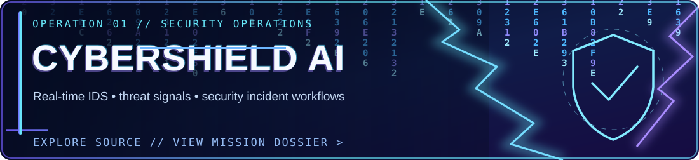
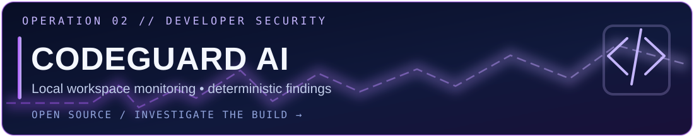
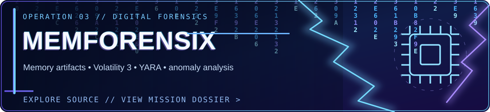

### Cybersecurity student • SOC analyst aspirant • Security tool builder

**Turn noise into signals. Turn signals into actionable defense.**

[Portfolio](https://dinesh-757.github.io/) &nbsp; • &nbsp; [Project dossiers](./PROJECT_SHOWCASE.md) &nbsp; • &nbsp; [LinkedIn](https://www.linkedin.com/in/dilli-dinesh) &nbsp; • &nbsp; [TryHackMe](https://tryhackme.com/p/Dinesh20)

## 01 / IDENTITY — The person behind the signal

I'm **Dilli Dinesh**, a final-year **B.E. CSE (Cyber Security)** student, building hands-on experience in **SOC operations, network defense, log analysis, and detection engineering**.

My approach connects offensive understanding with defensive engineering: learn the technique in an authorized environment, collect evidence, investigate what happened, and create tools that make detection easier.

| Field | Signal |
| :-- | :-- |
| **Primary track** | SOC analyst / Blue Team / detection engineering |
| **Investigating** | Network traffic, security logs, file activity, malicious indicators |
| **Building with** | Python, FastAPI, React, SQL, Linux, Docker |
| **Learning next** | SIEM investigations, threat hunting, incident response, purple teaming |
| **Guiding principle** | Test the implementation. Document what works **and** what does not. |

## 02 / FEATURED OPERATIONS — Projects with a purpose

**01 — CyberShield AI** · A multi-module security operations platform combining AI-assisted network intrusion detection, file/ransomware behavior analysis, security logs, threat intelligence, vulnerability scanning, incident workflows, and reports.

**Explore:** [Source and setup](https://github.com/Dinesh-757/CyberShield-AI) · [Technical dossier](./PROJECT_SHOWCASE.md#01--cybershield-ai--security-operations-platform)

**02 — CodeGuard AI** · A developer-security tool that monitors explicitly approved local workspaces, checks for exposed secrets, risky AI instructions and MCP configurations, and streams persisted findings to an authenticated dashboard.

**Explore:** [Source, runbook and tests](https://github.com/Dinesh-757/CodeGuard-AI) · [Technical dossier](./PROJECT_SHOWCASE.md#02--codeguard-ai--local-coding-workspace-security)

**03 — Memforensix** · A digital-forensics analysis pipeline exploring Volatility 3 process and network artifacts, YARA indicators, and anomaly detection. Its included sample follows a **synthetic fallback** demonstration path; real analysis requires a genuine memory image.

**Explore:** [Source and constraints](https://github.com/Dinesh-757/Memforensix) · [Technical dossier](./PROJECT_SHOWCASE.md#03--memforensix--memory-forensics-workbench)

> **Evidence matters:** Repository feature descriptions are not proof of independent production validation. Each project links to its setup, known limitations, and verification notes.

**[EXPLORE THE FULL PROJECT DOSSIERS →](./PROJECT_SHOWCASE.md)**

## 03 / ENGINEERING STACK — Tools I build and learn with

| Track | What I practice |
| :-- | :-- |
| **Blue Team / SOC** | Alert triage, packet inspection, log investigation, detection rules |
| **Digital forensics** | Evidence handling concepts, memory artifacts, investigative workflows |
| **Application security** | Scope-based scanning, code/configuration review, secret exposure |
| **Software engineering** | Backends, frontend dashboards, authentication, databases, testing |

Tools listed are technologies in my work or studies; this section does not claim formal certifications or professional mastery.

## 04 / LIVE SIGNAL — GitHub activity

  

This activity chart is served by a third-party service and may be temporarily unavailable.

## 05 / NEXT MISSION — Learning in public

My focus is to develop beyond surface-level demos: design measurable security workflows, test real event paths, understand false positives, and publish reproducible findings. I am building toward an entry-level **SOC analyst / cybersecurity engineering** role.

For detailed source and evidence, start with **[CyberShield AI](https://github.com/Dinesh-757/CyberShield-AI)**, **[CodeGuard AI](https://github.com/Dinesh-757/CodeGuard-AI)**, or **[Memforensix](https://github.com/Dinesh-757/Memforensix)**.

Security research and testing are for educational and authorized environments only. Lightning animations, where supported, are decorative SVG effects; GitHub does not allow scripts or custom styling of the surrounding site.

