**Cybersecurity student · SOC / Blue Team track · Security product builder**

*Turning raw signals into investigations, and investigations into better defenses.*

<a href="#operator-brief">01 · About</a> &nbsp; / &nbsp; <a href="#featured-operations">02 · Projects</a> &nbsp; / &nbsp; <a href="#capability-map">03 · Skills</a> &nbsp; / &nbsp; <a href="#public-telemetry">04 · Activity</a> &nbsp; / &nbsp; <a href="#next-signal">05 · Connect</a>

## 01 / OPERATOR BRIEF — Beyond the dashboard

I'm **Dilli Dinesh**, a final-year **B.E. CSE (Cyber Security)** student focused on becoming a **SOC analyst** and building security tools with understandable, testable behavior.

I like security engineering that starts with a real question: **What happened, how do we know, and what should we do next?** I explore that question through packet capture, alert pipelines, logs, file activity, and digital forensic workflows — in authorized environments.

<table>
<tr>
<td width="50%" valign="top">

**🔎 Investigating now**

Network packets, suspicious files, log anomalies, indicators of compromise, and detection quality.

</td>
<td width="50%" valign="top">

**🧠 Expanding next**

SIEM investigations, detection engineering, threat hunting, incident response, and purple-team techniques.

</td>
</tr>
<tr>
<td valign="top">

**⚙️ Building with**

Python · FastAPI · React · TypeScript · SQL · Linux · Docker

</td>
<td valign="top">

**🎯 Career direction**

SOC / Blue Team operations and security engineering, supported by hands-on projects and documented tests.

</td>
</tr>
</table>

### My security workflow, visualized

*Collect signals → analyze evidence → investigate context → document findings and improve defenses.*

## 02 / FEATURED OPERATIONS — Three problems, three builds

**CyberShield AI** — A multi-module security operations platform exploring network intrusion detection, ransomware behavior monitoring, security logs, threat intelligence, authorized vulnerability checks, incident workflows and PDF reporting.

<b>Explore CyberShield AI</b> — source, documentation &amp; verification

**Explore:** [Source and architecture](https://github.com/Dinesh-757/CyberShield-AI) · [Technical dossier](./PROJECT_SHOWCASE.md#01--cybershield-ai--security-operations-platform)

**CodeGuard AI** — A local workspace security monitor for risky AI instructions, exposed secrets, unsafe MCP configuration and dependency indicators, with authenticated dashboards and persisted file-event findings. Its documentation identifies validation still pending.

<b>Explore CodeGuard AI</b> — source, documentation &amp; verification

**Explore:** [Source and runbook](https://github.com/Dinesh-757/CodeGuard-AI) · [Test guidance](https://github.com/Dinesh-757/CodeGuard-AI#tests) · [Technical dossier](./PROJECT_SHOWCASE.md#02--codeguard-ai--local-coding-workspace-security)

**Memforensix** — A digital memory-forensics investigation workbench using Volatility 3 paths, YARA rules and anomaly detection. Its bundled example uses a **synthetic fallback**, not a genuine forensic memory image.

<b>Explore Memforensix</b> — source, documentation &amp; verification

**Explore:** [Source and setup](https://github.com/Dinesh-757/Memforensix) · [Data limitations](https://github.com/Dinesh-757/Memforensix#important-about-the-forensics-in-this-demo) · [Technical dossier](./PROJECT_SHOWCASE.md#03--memforensix--memory-forensics-workbench)

> **Build philosophy:** I want the implementation to be reviewable, not just the screenshots. Listed capabilities are based on repository documentation; they are not claims of independently verified production readiness.

**[OPEN ALL PROJECT DOSSIERS →](./PROJECT_SHOWCASE.md)**

## 03 / CAPABILITY MAP — Tools and techniques

Rather than listing every security product, here's where my projects and learning connect:

| Area | What I work on | Supporting technology |
| :--- | :--- | :--- |
| **Security operations** | Traffic inspection, alert triage, event correlation, threat indicators | Wireshark, Scapy, Linux, SIEM concepts |
| **Detection & analysis** | Rule-based detection, ML inference, event streams, review workflows | Python, scikit-learn, WebSockets |
| **Digital forensics** | Process / network artifacts, YARA indicators, memory-analysis pipelines | Volatility 3, YARA |
| **Application security** | Scoped vulnerability checks, secret exposure, configuration and dependency risks | Nmap, HTTP checks, deterministic scanners |
| **Full-stack engineering** | Backend APIs, dashboards, authentication, persistence and reporting | FastAPI, React, TypeScript, PostgreSQL, Docker |

Skills and tools describe hands-on work or current study, not professional certifications or verified mastery.

## 04 / PUBLIC TELEMETRY — Code in motion

These charts use the contribution counts displayed on my public GitHub profile. The date printed on the calendar identifies the latest snapshot. Contribution counts are not a measure of skill.

<b>More activity details</b> — languages &amp; native contribution history

[Open native GitHub contribution history](https://github.com/Dinesh-757?tab=overview)

The optional language card uses a third-party service and may be unavailable temporarily; language usage is not a measure of skill.

## 05 / NEXT SIGNAL — Build, test, explain, repeat

I am preparing for an entry-level **SOC analyst / cybersecurity engineering** role by turning security concepts into reproducible workflows. My priorities are evidence-backed detections, understandable false positives, safe authorization boundaries, and honest technical documentation.

**Open a project:** [CyberShield AI](https://github.com/Dinesh-757/CyberShield-AI) · [CodeGuard AI](https://github.com/Dinesh-757/CodeGuard-AI) · [Memforensix](https://github.com/Dinesh-757/Memforensix)

### Have a security engineering idea or want to collaborate?

[LinkedIn](https://www.linkedin.com/in/dilli-dinesh) · [Portfolio](https://dinesh-757.github.io/) · [TryHackMe](https://tryhackme.com/p/Dinesh20) · [GitHub projects](https://github.com/Dinesh-757?tab=repositories)

All security research and testing should be performed in authorized environments. Lightning and falling-code visuals are decorative SVG animations where supported; GitHub does not allow scripts to restyle its website.

