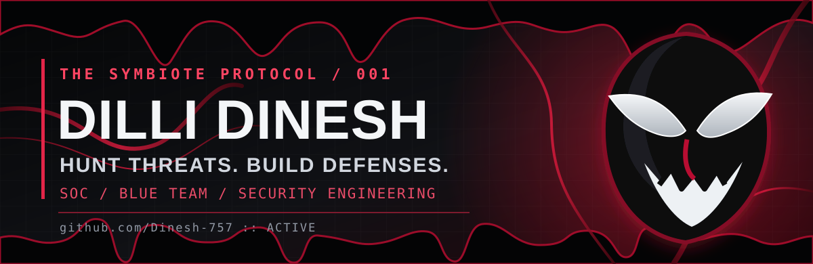

<div align="center">



<br/>

[](https://github.com/Dinesh-757)
[](https://github.com/Dinesh-757)
[](https://github.com/Dinesh-757)


**Cybersecurity student · SOC analyst aspirant · Builder of defensive security tools**

*Inspired by the relentless nature of a symbiote; grounded in evidence, engineering and ethical security.*

[Explore Projects](./PROJECT_SHOWCASE.md) · [LinkedIn](https://www.linkedin.com/in/dilli-dinesh) · [TryHackMe](https://tryhackme.com/p/Dinesh20)

</div>


## `01 / IDENTITY` — Who am I?

I'm **Dilli Dinesh**, a B.E. Computer Science and Engineering (Cyber Security) student focused on **security operations, detection engineering, and practical defensive tooling**.

My work explores how to collect security telemetry, detect meaningful signals, investigate suspicious behavior and present findings to analysts. I'm also learning how offensive techniques inform better defenses — in authorized labs and test environments.

```text
[IDENTITY]        Dilli Dinesh
[MISSION]         Hunt threats. Build defenses.
[CURRENT FOCUS]   SOC analysis / SIEM / threat detection
[WORKING STYLE]   Design -> instrument -> test -> investigate -> improve
[ETHICS]          Authorized security research and education
```

## `02 / ACTIVE OPERATIONS` — Selected projects

<table>
  <tr>
    <th align="left">Operation</th>
    <th align="left">What it explores</th>
    <th align="left">Stack / evidence</th>
  </tr>
  <tr>
    <td><a href="https://github.com/Dinesh-757/CyberShield-AI"><strong>CYBERSHIELD AI</strong></a><br/><sub>Security operations</sub></td>
    <td>Network intrusion detection, ransomware behavior, log analysis, incident handling, intelligence and reporting.</td>
    <td>FastAPI · React · Scapy · scikit-learn<br/><a href="https://github.com/Dinesh-757/CyberShield-AI#readme">Repository & setup</a></td>
  </tr>
  <tr>
    <td><a href="https://github.com/Dinesh-757/CodeGuard-AI"><strong>CODEGUARD AI</strong></a><br/><sub>Developer security</sub></td>
    <td>Local workspace monitoring for suspicious code/configuration patterns, secrets and unsafe AI/MCP instructions.</td>
    <td>Python · Watchdog · React · WebSockets<br/><a href="https://github.com/Dinesh-757/CodeGuard-AI#readme">Implementation & limitations</a></td>
  </tr>
  <tr>
    <td><a href="https://github.com/Dinesh-757/Memforensix"><strong>MEMFORENSIX</strong></a><br/><sub>Digital forensics</sub></td>
    <td>Memory artifacts, YARA indicators and anomaly-analysis workflow with a documented synthetic demonstration mode.</td>
    <td>Volatility 3 · YARA · Celery · PostgreSQL<br/><a href="https://github.com/Dinesh-757/Memforensix#readme">Pipeline & caveats</a></td>
  </tr>
</table>

**[OPEN THE FULL PROJECT DOSSIERS →](./PROJECT_SHOWCASE.md)** — scope, technical trail, and verification notes for each project.


## `03 / TOOLKIT` — Security arsenal

<div align="center">


</div>

| Area | Current emphasis |
| :-- | :-- |
| **Monitoring & detection** | Packet inspection, security logs, IDS concepts, alerts and tuning |
| **Investigation** | Incident triage, indicators, network artifacts and memory forensics |
| **Application security** | Scoped workspace inspection, secret detection and configuration review |
| **Engineering** | Python, FastAPI, frontend dashboards, APIs, persistence and testing |

> Tools and topics here describe hands-on work and learning interests, not formal certifications or claims of professional mastery.

## `04 / SIGNALS` — GitHub activity

<div align="center">
  
</div>

<sub>External stats images depend on third-party availability and may occasionally fail to load.</sub>

## `05 / CURRENT OBJECTIVE` — The next evolution

I am developing a stronger foundation in **SOC operations, SIEM investigation, defensive telemetry and detection engineering**. My goal is to turn security concepts into tools that can be installed, tested, and critically evaluated — with limitations documented alongside results.

**Want to see the code instead of the claims?** Start with [CyberShield AI](https://github.com/Dinesh-757/CyberShield-AI), [CodeGuard AI](https://github.com/Dinesh-757/CodeGuard-AI) or [MEMFORENSIX](https://github.com/Dinesh-757/Memforensix).

<div align="center">


<sub>All security research and software are intended for educational purposes and authorized environments.</sub>

</div>
